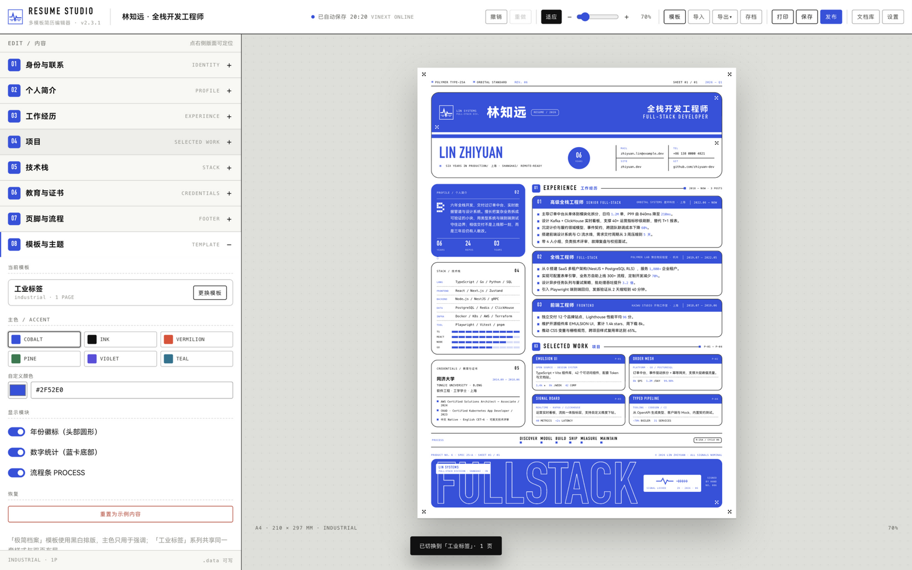
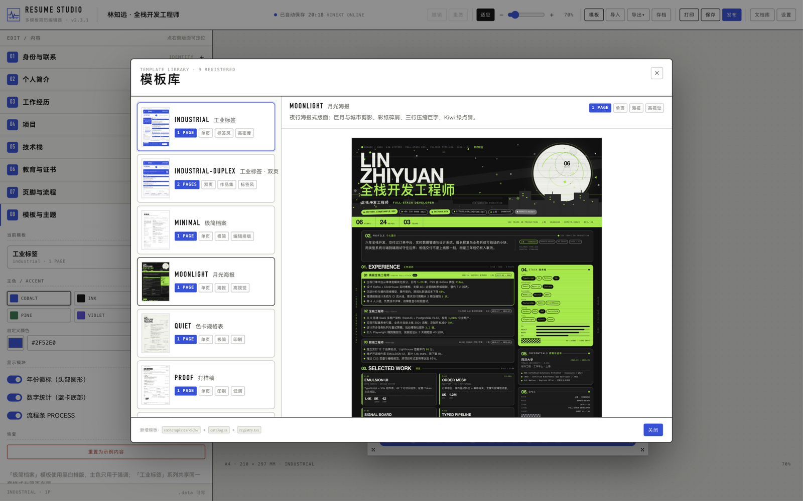
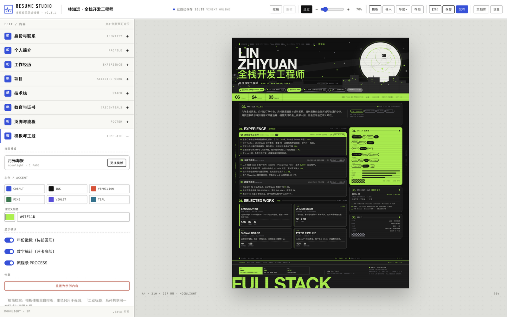

# RESUME STUDIO · vinext 全栈多模板简历编辑器

工业标签风简历模板 → 可视化编辑器 → **vinext（Next.js API on Vite）全栈应用**。
左侧表单实时编辑，右侧 A4 预览；支持 **多套模板 / 多页模板**、撤销重做、自动保存、文档库、发布分享、JSON / HTML 导出，并通过 **MCP** 把读写、渲染、发布能力开放给 AI 客户端。

## 截图

| 编辑器（工业标签模板） | 模板库 | 月光海报模板 |
| --- | --- | --- |
|  |  |  |

```
Next.js App Router on Vite (vinext 1.2 / Vite 8 / React 19 RSC)
├── app/                     路由：页面、Route Handlers、发布页
├── src/
│   ├── EditorApp.tsx        编辑器（client component）
│   ├── templates/           模板注册表：industrial / industrial-duplex / minimal / moonlight / quiet
│   ├── sections/            8 个编辑面板
│   ├── server/store.ts      文档与发布页存储（内嵌 libSQL 本地库）
│   └── ...
└── .data/                   本地数据（resume-studio.db，gitignore）
```

## 快速开始

```bash
npm install
npm run dev        # vinext dev → http://localhost:5173
```

生产：

```bash
npm run build
npm run start      # 默认 3000，被占用时：npx vinext start --port 3020
```

类型检查：`npm run check`。需要 Node 20+。

模板预览（不启动应用，直接渲染真 A4 + 截图 + 溢出测量）：

```bash
npm run preview:tpl -- moonlight      # 单个模板
npm run preview:tpl -- --all          # 全部模板
# → /tmp/tpl-preview/<id>.png (1600×2400) + <id>.html
# 输出行给出 page / flow 溢出像素与 FITS=yes|no
```

## 模板系统（多页 / 可扩展）

每个模板 = 一次 `defineTemplate()` 工厂调用（`src/templates/factory.tsx`），元数据、作用域 CSS 与渲染器同处声明；
`src/templates/registry.tsx` 是唯一事实源，服务端安全的元数据目录 `catalog.ts` 由它派生：

```ts
defineTemplate({
  id: "quiet",              // kebab-case → .t-<id> 作用域类 + 文件目录
  nameZh: "色卡规格表",
  description: "……",
  pages: 1,                 // 或 (data) => number 按内容分页
  accent: "#97F11D",        // 默认主色
  css: QUIET_CSS,           // 全部选择器作用域在 .t-<id>
  render: (data) => <QuietPage data={data} />,
})
```

当前内置：

| 模板 | 页数 | 说明 |
| --- | --- | --- |
| `industrial` | 1 | 原版工业标签：模切卡片、钴蓝条带、信号波形 / 套准标记 |
| `industrial-duplex` | 2 | 第 1 页身份 + 简介 + 履历 + 技能，第 2 页项目档案 + 证书 + 联系 |
| `minimal` | 1 | 极简编辑排版：细规则线、大字号姓名、黑白 + 主色强调 |
| `moonlight` | 1 | 月光海报：巨月与城市剪影、彩纸碎屑、三行压缩巨字，默认 Kiwi 绿 `#97F11D` |
| `quiet` | 1 | 色卡规格表：纸白印刷风、严格网格、编号即索引，主色只做线与编号 |

新增模板一条命令起步（生成骨架并自动注册）：

```bash
npm run tpl:new blueprint "蓝图"
```

契约、硬性约定、数据速查与常用配方见 **[docs/template-authoring.md](docs/template-authoring.md)**——
由 `tests/template-contract.test.ts` 对每个注册模板强制执行。

约定：页面根节点使用 `.tpl-page`，内容流包在 `.tpl-flow` 内（编辑器据此做 **逐页 A4 溢出检测**）；需要联动编辑面板的区块加 `data-panel="identity|profile|experience|projects|stack|education|flow|footer"`。

编辑器会自动：注入全部模板 CSS、渲染模板缩略图、显示页码 / 翻页器、打印与导出全部页面、切换模板时套用该模板默认主色（用户自定义主色则保留）。

## 编辑器能力

- **实时 A4 预览**：25%–400% 连续缩放（滑块 / ± / 适应），⌘/Ctrl+滚轮以光标为中心缩放、拖拽平移、双击空白处适应窗口，比例本地记忆；多页模板可翻页（PAGE 01 / 02）
- **点击定位**：点右侧版面任意区块 → 左侧展开对应表单
- **撤销 / 重做**：⌘Z / ⇧⌘Z；输入框内直接撤销会先提交编辑历史
- **原地增删排序**：经历、要点、项目、指标、技能、联系方式、流程步骤
- **指标高亮**：正文里 `日均 {1.2M} 单` → 蓝色等宽重点
- **模板库**：5 套实时缩略图，单击切换；模板默认主色自动适配
- **主题**：6 套主色 + 任意取色；年份徽标 / 统计 / 流程条可开关
- **溢出检测**：按当前页检测 `.tpl-flow`，超出 A4 顶部出现黄色警示
- **自动保存**：本地数据库工作区（400ms 防抖，`PUT /api/workspace`）+ 服务器静默同步
- **导出**：JSON（v2，含 `templateId`，兼容导入 v1）、自包含 HTML（全部页面）、打印 PDF
- **文档库**：服务器多份存档；打开走 `/?doc=<id>` 服务端渲染
- **发布**：`POST /api/publish` → 生成 `/p/<id>` 静态 HTML，复制链接即可分享

## 后端（vinext Route Handlers）

| 方法 | 路径 | 说明 |
| --- | --- | --- |
| GET | `/api/health` | 健康检查 + 已注册模板列表 |
| GET | `/api/update` | 检查更新：查 GitHub Releases 并返回统一 `UpdateCheck` JSON（`?platform=darwin\|win32\|linux`，10 分钟模块缓存，状态码恒为 200） |
| GET | `/api/mcp/info` | MCP 能力清单：端点、传输与鉴权说明、9 个工具 / 3 个资源 / 2 个提示词（含调用词）、可粘贴的客户端配置片段 |
| GET | `/api/docs` | 文档列表 |
| GET / PUT / DELETE | `/api/docs/:id` | 读取 / 保存 / 删除（`{ title, data }`） |
| GET / PUT | `/api/workspace` | 编辑器工作区（title + data + docId 单条记录，崩溃恢复即它） |
| GET / PUT | `/api/prefs` | UI 偏好（缩放 / 更新提示 / 每日检查标记），PUT 为部分更新 |
| POST | `/api/publish` | `{ id, title, html }` → 发布页（`published` 表） |
| GET | `/p/:id` | 返回已发布的完整 HTML |

本地数据库：`@libsql/client`（Turso 的嵌入式 libSQL）以 `file:` 模式打开
`<RESUME_DATA_DIR>/resume-studio.db`（WAL），docs / published / kv 三张表承载全部持久化；
桌面版数据目录是 `~/Library/Application Support/dev.linzhiyuan.resume-studio/`。首次启动会把旧版
`.data/docs/*.json` 与 `.data/published/*.html` 一次性导入（原文件保留作备份），浏览器里的旧
localStorage 键也会迁入工作区后清除。
`app/page.tsx` 是 **Server Component**：读取文档列表与 `?doc=` 指定文档后传入客户端编辑器；写操作全部走 Route Handlers。

## MCP（AI 客户端接入）

同一份简历数据通过 **MCP（Model Context Protocol）** 暴露给 AI 客户端。端点是 **无状态 Streamable HTTP** 的 vinext Route Handler，纯 Node 运行时，不需要 Cloudflare 适配器。

编辑器顶部的**设置页**里有一块「MCP 能力」：显示当前端点（绝对地址）、传输与鉴权状态、9 个工具 / 3 个资源 / 2 个提示词，每一项都附**可直接粘贴的调用词**，以及各客户端的配置片段；顶部还有**「测试连接」**一键自检（浏览器内直打端点跑 initialize → tools/list，展示服务身份、工具数与耗时；设置了 token 时 401 会标注为「端点可达、需在客户端配置鉴权」而非故障）。这份清单由 `src/mcp/catalog.ts` 提供，并由 `tests/mcp-catalog.test.ts` 与真实注册逐字比对，不会宣传服务端没有的能力。

```bash
npm run dev                                  # 端点：http://localhost:5173/api/mcp
npm run build && npm run start -- --port 3020  # 生产：http://localhost:3020/api/mcp
npm run mcp:smoke                            # HTTP 冒烟（MCP_URL 可覆盖地址）
npm test                                     # 工具单测 + InMemoryTransport 端到端
```

通用客户端配置（Streamable HTTP）：

```json
{
  "mcpServers": {
    "resume-studio": {
      "url": "http://localhost:5173/api/mcp",
      "headers": { "Authorization": "Bearer <RESUME_MCP_TOKEN>" }
    }
  }
}
```

- Claude Code：`claude mcp add --transport http resume-studio http://localhost:5173/api/mcp`
- 仅支持 stdio 的客户端（如 Claude Desktop）：`npx mcp-remote http://localhost:5173/api/mcp`
- 调试：`npx @modelcontextprotocol/inspector`，Transport 选 Streamable HTTP 并填写 URL。

### Tools

| 工具 | 说明 |
| --- | --- |
| `list_resumes` | 列出文档（id / 标题 / 更新时间 / 模板），支持 `templateId` 过滤、`query` 标题搜索、`sort` 排序 |
| `get_resume` | 读取完整 `ResumeData` + 模板元数据 |
| `save_resume` | 新建（缺省 id 自动生成）或整份覆盖 |
| `patch_resume` | RFC 7386 Merge Patch 局部修改（`null` 删除字段） |
| `duplicate_resume` | 复制为新文档（目标 id 已存在时报错，不覆盖；缺省标题「原标题 · 副本」） |
| `delete_resume` | 删除，幂等 |
| `check_resume` | 预检：返回模板 / 页数 / 字节 / 数据问题清单（filled / coerced / dropped），**不返回 html 正文**，避免大负载进对话 |
| `render_resume_html` | 服务端渲染多页自包含 HTML（可传 `id` 或临时 `data`） |
| `publish_resume` | 渲染并写入发布页（`published` 表），返回 `/p/<id>` |

### Resources / Prompts

- `resume://docs`、`resume://docs/{id}`、`resume://templates`（只读 JSON）
- `tailor_resume_to_job`（按 JD 定制）、`polish_resume`（润色文案）：引导模型先读后改、保留 `{指标}` 写法

### 环境变量

| 变量 | 默认 | 说明 |
| --- | --- | --- |
| `RESUME_DATA_DIR` | `<cwd>/.data` | 数据目录（内含 `resume-studio.db`），与 REST 共用 |
| `RESUME_MCP_TOKEN` | 空 | 设置后要求 `Authorization: Bearer <token>`；空 = 不鉴权（建议仅本机） |
| `RESUME_MCP_ALLOWED_ORIGINS` | 空 | 额外允许的浏览器 Origin，逗号分隔 |
| `RESUME_PUBLIC_URL` | 空 | 发布结果返回绝对地址 |

### 传输与安全

- `POST /api/mcp` 承载 JSON-RPC，响应按 Streamable HTTP 返回 SSE 流；`GET` 返回 `405`（无状态端点不提供独立 SSE 流），`OPTIONS` 处理 CORS 预检。
- 每个请求新建 server + transport，不保存会话；请求体上限 4 MiB、文档上限 2 MiB。
- 浏览器请求带 `Origin` 时必须与 Host 一致或命中 `RESUME_MCP_ALLOWED_ORIGINS`，否则 `403`。
- 全部工具声明 `outputSchema`，成功结果同时携带 `structuredContent` 与 text（旧客户端读 text 不受影响）；失败结果保持纯 text。
- 每次工具调用与鉴权 / Origin 拒绝都向 stdout 写一行 JSON 日志（`{ts, tool|event, ms, ok}`），dev 终端直接可见，桌面版进 server.log。
- `render_resume_html` 使用 `src/mcp/render.ts` 的元素树序列化器（RSC 环境会禁用 `react-dom/server`），产出与编辑器导出的 HTML 同构。

## 目录

```
app/
├── layout.tsx               Metadata + 全局 editor.css
├── page.tsx                 SSR：listDocs / readDoc → <EditorApp/>
├── icon.svg
├── api/health|docs|publish  Route Handlers
├── api/update/route.ts      检查更新（GitHub Releases + 10 分钟缓存）
├── api/mcp/route.ts         MCP Streamable HTTP 端点
└── p/[id]/route.ts          发布页
src/
├── EditorApp.tsx            编辑器外壳（工具栏 / 表单 / 预览 / 打印层）
├── mcp/
│   ├── handler.ts           鉴权 / Origin / 无状态 transport 生命周期 / 请求级日志
│   ├── server.ts            createMcpServer：注册三原语 + instructions
│   ├── tools.ts             9 个工具（zod schema + outputSchema + handler）
│   ├── audit.ts             归一化对比（check_resume 的问题清单）
│   ├── resources.ts         3 个只读资源
│   ├── prompts.ts           2 个提示词模板
│   ├── selftest.ts          浏览器侧端点自检（settings 页「测试连接」）
│   ├── catalog.ts           设置页能力清单（与真实注册逐字同步）
│   ├── render.ts            SSR 元素树 → 自包含 HTML
│   └── config.ts            环境变量与限制
├── templates/
│   ├── factory.tsx          defineTemplate 工厂：元数据 + CSS + 渲染器一次声明
│   ├── catalog.ts           派生的模板元数据（服务端安全）
│   ├── registry.tsx         模板注册表（唯一事实源）+ CSS 聚合
│   ├── types.ts             模板契约（TemplateDefinition / PANEL_IDS）
│   ├── validate.tsx         契约校验器（仅测试/脚本可用）
│   ├── industrial/          pages.tsx + styles.ts（原版 + 双页）
│   ├── minimal/             MinimalPage.tsx + styles.ts
│   ├── moonlight/           MoonlightPage.tsx + styles.ts（暗底海报）
│   └── quiet/               QuietPage.tsx + styles.ts（纸白规格表）
├── components/              Accordion / fields / TemplatePicker / LibraryModal
├── sections/                8 个编辑面板
├── lib/                     store / overflow / backend / exporters / migrate
├── server/store.ts          fs 存储
├── styles/                  editor.css、pages.ts（A4 + 导出壳）
├── data/defaultResume.ts    示例内容
└── types.ts                 ResumeData v2
tests/                       工具单测 + MCP 端到端
scripts/mcp-smoke.mjs        真实 HTTP 冒烟
```

## 打印 / 字体

- 打印：A4、边距「无」、勾选「背景图形」；多页模板每页自动分页。
- 字体使用系统自带：DIN Condensed、HarmonyOS Sans SC、SF Mono（含 Arial Narrow / PingFang 回退）。
- 导出的 HTML 与发布页不依赖本项目 JS/CSS，可独立打开与二次分发。

## 桌面版（Tauri）

Tauri 只提供 WebView，而本项目是 Node 全栈服务（Route Handlers + 内嵌 libSQL 本地库 + MCP）。
因此桌面壳内置一份 Node 运行时：启动时挑一个空闲端口拉起 `vinext start`，等端口就绪再开窗口，
退出时杀掉子进程。

```bash
npm run desktop:runtime   # 构建 + 组装 runtime/（node + node_modules + dist，约 250MB）
npm run desktop:build     # 上一步 + tauri build → .app / .dmg
npm run desktop:dev       # 只调壳：窗口指向已在跑的 http://localhost:5173
```

产物：`src-tauri/target/release/bundle/{macos,dmg}`。

- `runtime/` 里的 node 会按宿主架构 `lipo -thin`；依赖用 `npm ci --omit=dev` 装出**真实的生产树**（不手工裁剪，避免删掉 `rolldown` 这类运行时传递依赖）。
- 组装脚本自带冒烟：把 `runtime/` 复制到**项目目录之外**再起服务、拉 `/api/health` 与首页。必须隔离，否则 Node 会沿目录向上找到项目自己的 `node_modules`，把缺失依赖藏起来。
- 应用数据目录：`~/Library/Application Support/dev.linzhiyuan.resume-studio`（文档库与 `server.log`）。
- 已知限制：macOS 的 WKWebView 不支持 `window.print()`，桌面版导出 PDF 请走「导出 HTML」再在浏览器打印。

### 检查更新

设置页的「检查更新」走 `GET /api/update`：服务端查 GitHub Releases（`RESUME_UPDATE_ENDPOINT` 可换端点，`RESUME_UPDATE_REPO` 换 `owner/repo`，`RESUME_UPDATE_CACHE_MS` 调缓存时长，默认 10 分钟），
有新版本时给出对应平台的安装包链接（macOS 优先 `.dmg`、Windows 优先 `-setup.exe`）。
**本期只提示、不自动安装**：弹窗展示版本号、更新说明与下载链接，由用户自己下载安装。

## CI（GitHub Actions）

`.github/workflows/desktop.yml`：

- `verify`：`npm run check` + `npm test`（ubuntu）
- `bundle`：矩阵构建 **macOS arm64**（`.app` + `.dmg`）与 **Windows x64**（NSIS `.exe`），产物上传到 Actions artifacts（保留 30 天）
- `release`：打 `v*` tag 时自动创建 **GitHub Release**，附上安装包（`.dmg` / `-setup.exe`；`.app.zip` 仅留在 Actions artifacts），发行说明按提交自动生成。产物统一命名 `ResumeStudio-v<版本>-<平台>`，如 `ResumeStudio-v2.3.1-macOS-arm64.dmg`、`ResumeStudio-v2.3.1-windows-x64-setup.exe`

触发方式：手动 `workflow_dispatch`、push 到 `master`/`main` 且改动 `src-tauri/**` 等桌面相关路径、或打 `v*` tag。

发版：`git tag v2.1.0 && git push origin v2.1.0` —— 构建完成后自动出现在仓库 Releases 页面。
macOS 任务在打包后会**把 .app 复制到 /tmp 并真启动一次**、拉 `/api/health` 验证，避免「job 绿但产物打不开」。

## 说明

- 目标运行时为 **Node**（vinext 的 Node 平台），MCP 端点同样跑在 Node 上；本期不考虑 Cloudflare Workers。如果部署到 Workers，需要把 `src/server/store.ts` 换成 KV/R2/D1 实现，其余代码不变。
- MCP 设计文档：`docs/superpowers/specs/2026-10-19-mcp-design.md`。
- vinext 仍处于快速迭代期，本项目只使用其稳定的 App Router / Route Handler 能力。
